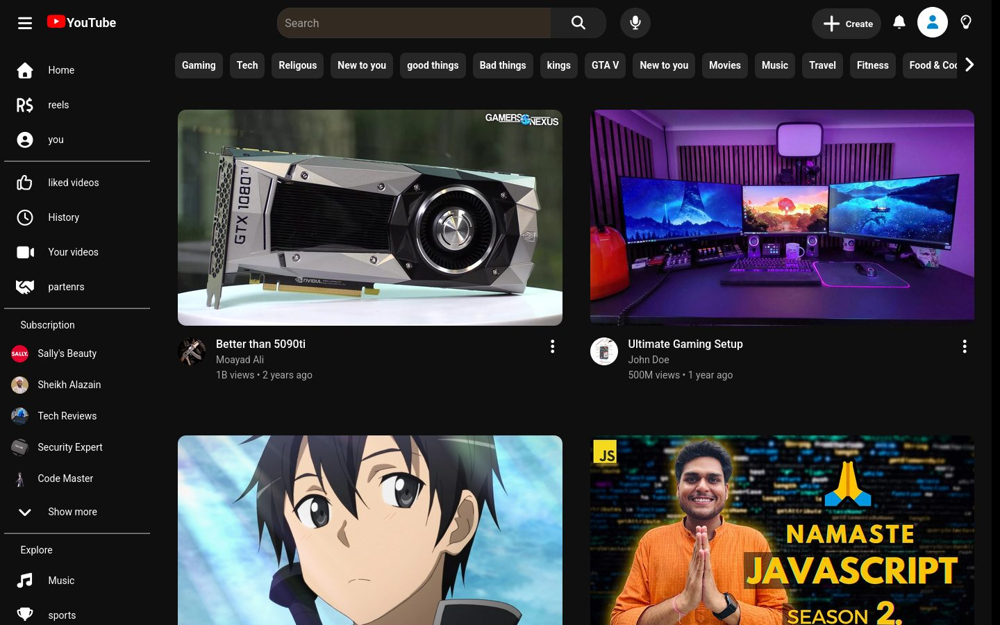
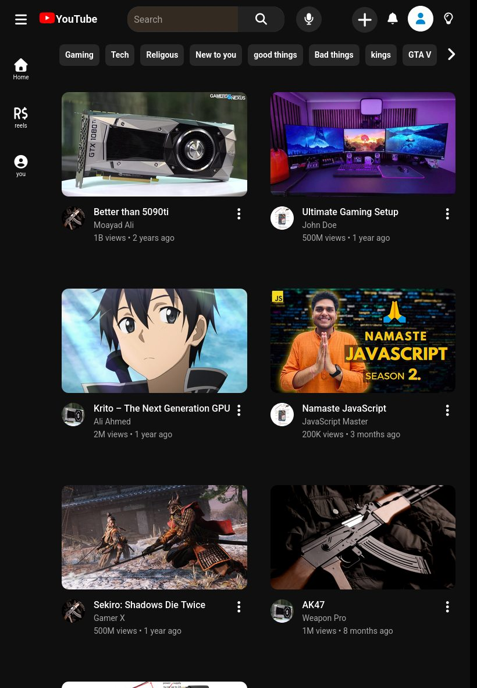
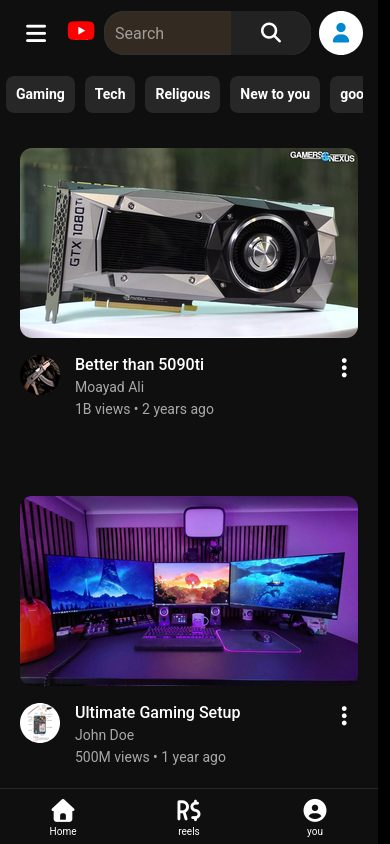
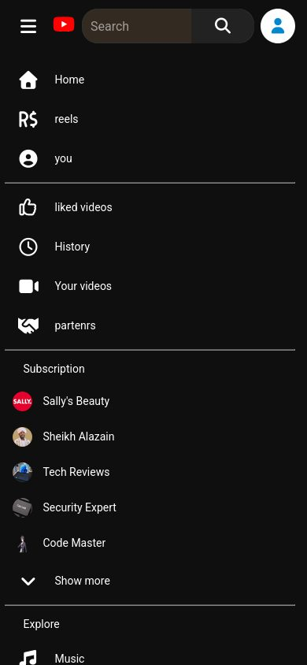

# YouTube Clone

A clone of the YouTube home page, built from scratch with plain HTML, CSS and
JavaScript. No frameworks, no libraries except the icons. I made it to get
better at layout and responsive design, and it works on desktop, tablet and
phone.



## Features

- **Header** with search, voice search, Create, notifications and profile buttons
- **Side menu** that expands from an icon bar into the full menu, with
  sections for your library, subscriptions and explore
- **Subscriptions list** that shows a few channels with "Show more" and
  "Show less"
- **Category chips** that scroll with arrow buttons on desktop, or with a
  swipe on touch screens
- **Video grid** that changes the number of columns with the screen size,
  with thumbnails that keep their 16:9 shape
- **Reels row** in the Shorts style that scrolls left and right
- **Dark theme**, with the main colors kept in CSS variables

## Responsive design

The layout changes at three sizes:

- **Desktop:** icon bar on the left that opens into the full menu and pushes
  the videos over
- **Tablet:** two video columns, smaller header buttons
- **Phone:** one video per row, a bottom tab bar (Home, reels, you) like the
  YouTube app, and a menu that opens over the whole screen

<table>
  <tr>
    <th>Tablet</th>
    <th>Phone</th>
    <th>Phone menu</th>
  </tr>
  <tr>
    <td></td>
    <td></td>
    <td></td>
  </tr>
</table>

## What I practiced

- Flexbox for the header, menu and cards, and CSS Grid (`auto-fit` and
  `minmax`) for the video grid
- `position: fixed` and `position: sticky`, and when to use each one
- Media queries, `aspect-ratio` and `object-fit` for images that scale cleanly
- Scroll snapping for the reels row
- DOM work in JavaScript: `classList.toggle`, click handlers, `scrollTo`, and
  reading element sizes to keep the layout in line with the menu

## Run it

No build step. Clone the repo and open `index.html` in a browser:

```bash
git clone https://github.com/Kirito344/youtube-clone-practice.git
cd youtube-clone-practice
```

The icons come from Font Awesome, so they need an internet connection.

## Built with

- HTML
- CSS
- JavaScript
- [Font Awesome](https://fontawesome.com/) icons and the Roboto font from Google Fonts

> This is a practice project for learning. It is not affiliated with YouTube,
> and the videos and pictures are placeholders.
